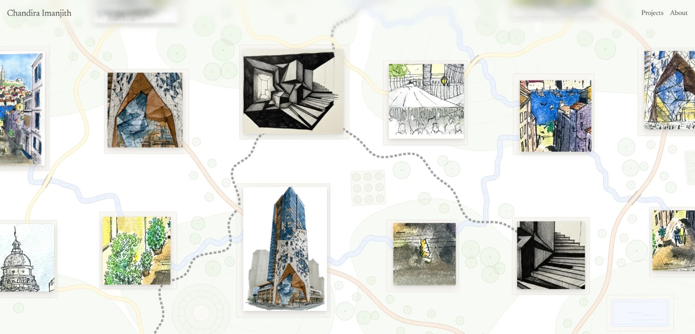

# Chandira Imanjith — portfolio

Sketches and studies in ink and watercolor by Chandira Imanjith, a first-year architecture student at the City School of Architecture, Colombo.

## Getting around

- **Home** is a park map with every drawing on it. Drag to wander, scroll or pinch to zoom, or use the arrow keys and `+` / `−`.
- Each project follows its own route through the park: a boardwalk, stepping stones, a sand path or a stream.
- **Click a drawing** to open its project, where the piece is shown whole and then broken into the details that make it.
- **Projects** lists every project in one place.
- **About** has a short introduction, with a contact form below it.

## Getting in touch

The contact form doesn't send anything itself: it opens your own email app with the note ready to send. You can also write directly to [imangithchandira@gmail.com](mailto:imangithchandira@gmail.com) or connect on [LinkedIn](https://www.linkedin.com/in/chandira-imanjith-b4b7283a2).

## Using the drawings

All drawings are © Chandira Imanjith. Please ask before reusing them.
